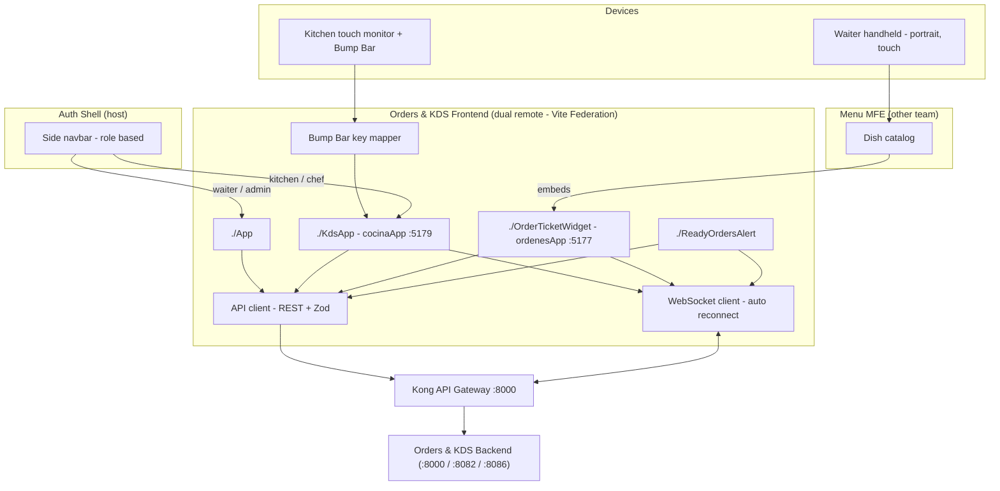
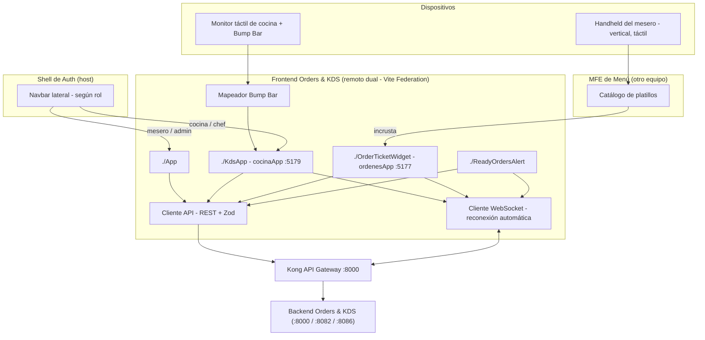

# Orders & KDS — Frontend

[](https://react.dev)
[](https://www.typescriptlang.org)
[](https://tailwindcss.com)
[](https://vitejs.dev)
[](https://github.com/originjs/vite-plugin-federation)
[](https://vitest.dev)
[](https://playwright.dev)
[](https://github.com/features/actions)
[](https://sonarcloud.io)

---

**Orders & KDS** is the *Orders and Kitchen* microservice (Microservice 4) of a distributed restaurant management system. This repository contains its **frontend**, built as a **dual Module Federation remote** (`ordenesApp` on `:5177` and `cocinaApp` on `:5179`) so this team keeps full control over the kitchen screen, shift controls, the order ticket widget and the ready-orders alert. It talks to the backend (`orders-backend`) through REST and WebSockets behind the Kong API Gateway (`:8000`), which routes `/api/v1/orders` and `/api/v1/kitchen`.

The exposed modules serve two distinct physical devices, and the UI is designed around them:

| Users | Device | Orientation | Interaction |
|---|---|---|---|
| **Waiters** *(through `OrderTicketWidget` embedded in Menu MFE)* | Android handheld POS or rugged 8" tablet | Portrait | One-handed touch, container-query responsive buttons |
| **Kitchen staff (KDS)** | Wall-mounted industrial touch monitor | Landscape | **Touch-first** (≥ 64 px targets, 400 ms debounce) with **100% keyboard / Bump Bar parity** (numeric shortcuts, arrows, `Enter`, `Backspace`) |

### Views / Exposed Modules

This repository exposes **five** federated modules through `@originjs/vite-plugin-federation`:

| # | Exposed module | Federation key | Loaded by | Users | Purpose |
|---|---|---|---|---|---|
| 1 | **App** | `./App` | **Auth Shell** | Waiter / Kitchen / Chef / Admin | Role-aware federated entrypoint (routes to KDS or Order Ticket) |
| 2 | **KDS App** | `./KdsApp` | **Auth Shell** (`cocinaApp:5179`) | Kitchen / Chef / Admin | Priority Kanban board, station filter, grace-period tab (`Caducados`), shift controls, Bump Bar + touch |
| 3 | **Intermediate Dishes App** *(NO-GO)* | `./IntermediateDishesApp` | **Auth Shell** | Chef | Feature-flagged placeholder (`INTERMEDIATE_DISHES_ENABLED=false`) |
| 4 | **Order Ticket Widget** | `./OrderTicketWidget` | **Menu MFE** / **Auth Shell** (`ordenesApp:5177`) | Waiter / Admin | Isolated ticket widget with **Confirm**, **Cancel**, **Modify** and `rejectionDetails` |
| 5 | **Ready Orders Alert** | `./ReadyOrdersAlert` | **Sala / Waiter MFE** | Waiter | Accessible `aria-live` alert for `DELIVERED` orders assigned to the waiter |

### Table of Contents

- [Team Members](#team-members)
- [Technology Stack](#technology-stack)
- [Architecture Overview](#architecture-overview)
- [Inter-Service Communication & Event Contracts](#inter-service-communication--event-contracts)
- [Quick Start](#quick-start)
- [Project Structure](#project-structure)
- [Running Tests](#running-tests)
- [Documentation](#documentation)
- [Contributing](#contributing)

---

### Team Members

| # | Name | Role | GitHub | Contact |
|---|---|---|---|---|
| 1 | Suarez Balam Brandon Emanuel| Networking, Security & Concurrency Lead | [@BS435](https://github.com/BS435) | |
| 2 | Contreras Gamboa Emiliano | Backend Architect | [@EmiCG](https://github.com/EmiCG) | |
| 3 | Dzib Pech Luis Gilberto| V&V/QA Lead | [@LuisGilDzib](https://github.com/LuisGilDzib) | |
| 4 | Martínez Martínez José Pablo | Scrum Master | [@Jose-Pablo-Martinez](https://github.com/Jose-Pablo-Martinez) | |
| 5 | Matu Aguayo Leonardo Daniel | Frontend Architect | [@leonardodanielmaguayo-hub](https://github.com/leonardodanielmaguayo-hub) | |
| 6 | Vega Nolasco Erick Ricardo| Database Lead | [@eriveingsoft](https://github.com/eriveingsoft) | |

---

### Technology Stack

#### Application
| Technology | Version | Purpose |
|---|---|---|
|  | `^18.3.1` | Component-based UI; shared singleton across Module Federation |
|  | `~6.0.2` (`strict`) | Strict typing aligned with the backend API and event contracts |
|  | `^3.4.19` | Utility-first styling scoped to `.orders-kds-root` (Preflight disabled) + light/dark themes |
|  | `^8.3.3` | Dev server, preview server and build tool |
| **@originjs/vite-plugin-federation** | `^1.4.1` | Dual Module Federation builds (`ordenesApp` `:5177`, `cocinaApp` `:5179`) |
| **TanStack Query** | `^5.104.4` | Server-state fetching, caching and mutation handling |
| **Zod** | `^4.6.7` | Runtime validation of API responses and WebSocket messages |

#### Infrastructure & DevOps
| Technology | Purpose |
|---|---|
|  | CI/CD pipeline: lint, type-check, build, Vitest, Playwright E2E, axe-core, OWASP ZAP, SonarCloud |
|  | Static analysis, Quality Gate and coverage tracking |
|  | Multi-stage unprivileged Nginx build (`BUILD_MODE=production` / `BUILD_MODE=cocina`) |

#### Testing
| Technology | Purpose |
|---|---|
|  + **React Testing Library** | Unit and component tests (`tests/unit/`) |
| **MSW** (Mock Service Worker) | Mocks REST and WebSocket traffic (`tests/mocks/`) |
|  | End-to-end tests (`e2e/`, Chromium Desktop, `chromium-touch`, WebKit) |
| **@axe-core/playwright** | Automated WCAG 2.1 AA accessibility checks (`e2e/a11y.spec.ts`) |

---

### Architecture Overview



Every HTTP request goes through the Kong API Gateway (`:8000`, `/api/v1/orders` and `/api/v1/kitchen`) or directly to `orders-backend` (`:8000`) during local development.

Design rules:

- **The UI never decides business rules.** Transitions, permissions, and dish availability are enforced by the backend.
- **No global styles.** Preflight is disabled; every module scopes styles under `.orders-kds-root` and supports `[data-theme="dark"]`.
- **Touch-first KDS with full Bump Bar parity.** Primary targets are ≥ 64 px with 400 ms debounce and keyboard parity (RNF-07, OP-06).
- **Real-time push.** Live updates arrive over `/ws/kds` and `/ws/waiter`.

---

### Inter-Service Communication & Event Contracts

Orders & KDS interacts with external microservices asynchronously via RabbitMQ on the backend and consumes REST + WebSockets from the frontend (`/orders`, `/kds/queue`, `/shifts/*`, `/ws/kds`, `/ws/waiter`). See [`docs/API_COMUNICACIONES.md`](docs/API_COMUNICACIONES.md) and [`docs/contratos_y_mensajes_integracion_ordenes_kds.md`](docs/contratos_y_mensajes_integracion_ordenes_kds.md) for full details.

---

### Quick Start

#### Prerequisites

- **Node.js** 24 LTS — [nodejs.org](https://nodejs.org)
- **pnpm** 9+ (`corepack enable` or `npm install -g pnpm`)
- **Git** 2.40+
- **Docker Desktop** (for running `orders-backend` locally or building the frontend Nginx image)

> Exact step-by-step joint startup with `orders-backend`, standard single-image Docker setup (plus optional `cocinaApp` federated build), ports and troubleshooting: [QUICKSTART.md §5–§7](QUICKSTART.md).
>
> Docker guide (single standard image + optional dual-remote mode): [docs/GUIA_DOCKER.md](docs/GUIA_DOCKER.md).

#### Installation

**Option A — automated bootstrap (recommended for a clean machine):**

```powershell
# Windows PowerShell
git clone https://github.com/FMAT-Restaurant/OrdersKDS-Frontend.git
cd OrdersKDS-Frontend
.\scripts\bootstrap.ps1
```

```bash
# macOS / Linux
git clone https://github.com/FMAT-Restaurant/OrdersKDS-Frontend.git
cd OrdersKDS-Frontend
bash scripts/bootstrap.sh
```

**Option B — manual steps:**

```bash
# 1. Clone the repository
git clone https://github.com/FMAT-Restaurant/OrdersKDS-Frontend.git
cd OrdersKDS-Frontend

# 2. Install dependencies
pnpm install --frozen-lockfile

# 3. Set up environment variables (defaults to VITE_API_BASE_URL=auto, VITE_WS_URL=auto)
cp .env.example .env.local

# 4. Install Playwright browsers (first time only)
pnpm exec playwright install --with-deps chromium webkit

# 5. Start the development server (http://localhost:5177)
pnpm dev
```

For the Vite dev/preview servers, configure federated host origins with
`VITE_CORS_ALLOWED_ORIGINS` (comma-separated; defaults to `http://localhost:5173`
and `http://127.0.0.1:5173`). Add deployment-specific API/WebSocket origins to
`VITE_CSP_CONNECT_SRC` and additional remote script/style origins to
`VITE_CSP_FEDERATION_SRC` when needed. Production responses do not allow inline
styles; KDS components use the bundled stylesheet. Development retains Vite's
inline CSS injection allowance for HMR only.

To build and preview both Module Federation remotes locally:

```bash
pnpm run dev:federation         # ordenesApp -> http://localhost:5177/assets/remoteEntry.js
pnpm run dev:federation:cocina  # cocinaApp  -> http://localhost:5179/assets/remoteEntry.js
```

---

### Project Structure

```
orders-frontend/
├── .github/
│   ├── ISSUE_TEMPLATE/
│   ├── PULL_REQUEST_TEMPLATE.md
│   └── workflows/
│       └── ci.yml                     # Lint + types + build + unit + E2E + a11y + ZAP + Sonar
│
├── src/
│   ├── App.tsx                        # Federation export: ./App
│   ├── KdsApp.tsx                     # Federation export: ./KdsApp
│   ├── OrderTicketWidget.tsx          # Federation export: ./OrderTicketWidget
│   ├── ReadyOrdersAlert.tsx           # Federation export: ./ReadyOrdersAlert
│   ├── IntermediateDishesApp.tsx      # Federation export: ./IntermediateDishesApp (NO-GO)
│   ├── DevSandboxApp.tsx              # Local standalone dev harness
│   ├── main.tsx                       # Local browser entrypoint
│   ├── index.css                      # Scoped .orders-kds-root & dark theme design tokens
│   ├── constants/                     # bumpBarKeyMap.ts
│   ├── hooks/                         # useBumpBar.ts
│   ├── features/
│   │   ├── dev-sandbox/               # Local sandbox fetch simulator
│   │   ├── kds-board/                 # KdsBoard, OrderCard, ShiftControlBar, dialogs, grace store
│   │   ├── order-ticket/              # OrderTicketWidget sections, RedoItemDialog, actions
│   │   └── ready-orders-alert/        # Waiter ready-order banner
│   └── shared/
│       ├── api/                       # REST client, Zod schemas, shifts API, devErrorLogger
│       ├── realtime/                  # KdsWebSocketClient
│       ├── i18n/                      # Spanish error translations
│       └── types/                     # Auth & domain types
│
├── tests/
│   ├── unit/                          # Vitest + RTL unit/component tests
│   ├── e2e/host-stub/                 # CSS isolation stub used by Playwright
│   └── mocks/                         # MSW handlers and fixtures
│
├── e2e/                               # Playwright specs (app, css-isolation, a11y, kds-touch, order-ticket-container)
├── docs/                              # Project documentation
├── scripts/                           # bootstrap.ps1, bootstrap.sh
├── QUICKSTART.md
├── playwright.config.ts
├── vite.config.ts                     # Vite + Module Federation + Vitest config
├── tailwind.config.ts                 # Design tokens; Preflight disabled
├── sonar-project.properties
├── Dockerfile
├── .dockerignore
└── .env.example
```

---

### Running Tests

```bash
# Build federation bundle (required before css-scoping.test.ts)
pnpm run build

# Unit and component tests
pnpm run test:unit

# With coverage report
pnpm run test:coverage

# Lint and TypeScript type checking
pnpm run lint && pnpm exec tsc --noEmit

# End-to-end tests (Chromium + WebKit, headless)
pnpm run test:e2e

# Accessibility checks (axe-core WCAG 2.1 AA)
pnpm run test:a11y
```

---

### Documentation

Full documentation is in the [`docs/`](docs/) folder:

| Document | Description |
|---|---|
| [`ERS_ordeneskds.md`](docs/ERS_ordeneskds.md) | Software Requirements Specification (v4) |
| [`Arquitectura_ordeneskds.md`](docs/Arquitectura_ordeneskds.md) | Complete architecture and exposed modules |
| [`API_COMUNICACIONES.md`](docs/API_COMUNICACIONES.md) | REST, WebSocket and broker communication |
| [`contratos_y_mensajes_integracion_ordenes_kds.md`](docs/contratos_y_mensajes_integracion_ordenes_kds.md) | Integration contracts and DOM/WS events |
| [`FMAT_RESTAURANT_Guia_Visual_Componentes.md`](docs/FMAT_RESTAURANT_Guia_Visual_Componentes.md) | Shared visual guide for every micro frontend |
| [`DEVELOPMENT_GUIDELINES.md`](docs/DEVELOPMENT_GUIDELINES.md) | Coding standards and rules |
| [`VyV_OrdenesKDS.md`](docs/VyV_OrdenesKDS.md) | Verification & Validation plan |
| [`CONTRIBUTING_Frontend.md`](docs/CONTRIBUTING_Frontend.md) | Frontend contribution guidelines and workflow |
| [`GUIA_DOCKER.md`](docs/GUIA_DOCKER.md) | Single standard Docker image + optional dual-remote `cocinaApp` guide |

---

### Contributing

1. Read [`docs/DEVELOPMENT_GUIDELINES.md`](docs/DEVELOPMENT_GUIDELINES.md) and [`docs/CONTRIBUTING_Frontend.md`](docs/CONTRIBUTING_Frontend.md) before contributing.
2. Create a branch from `develop`:
   ```bash
   git checkout -b feat/your-feature-name
   ```
3. Make sure everything passes locally before opening a PR:
   ```bash
   pnpm run lint && pnpm exec tsc --noEmit
   pnpm run build && pnpm run build:cocina
   pnpm run test:unit && pnpm run test:e2e && pnpm run test:a11y
   ```
4. Open a Pull Request against `develop`.

---
---

## Español

**Orders & KDS** es el microservicio de *Órdenes y Cocina* (Microservicio 4) de un sistema distribuido de gestión de restaurantes. Este repositorio contiene su **frontend**, construido como **remoto dual de Module Federation** (`ordenesApp` en `:5177` y `cocinaApp` en `:5179`) para mantener control total sobre la pantalla de cocina, controles de turno, el widget de ticket de comanda y la alerta de órdenes listas. Se comunica con el backend (`orders-backend`) mediante REST y WebSockets detrás del API Gateway Kong (`:8000`), que enruta `/api/v1/orders` y `/api/v1/kitchen`.

Los módulos expuestos atienden dos dispositivos físicos distintos:

| Usuarios | Dispositivo | Orientación | Interacción |
|---|---|---|---|
| **Meseros** *(mediante `OrderTicketWidget` incrustado en el MFE de Menú)* | Handheld POS Android o tablet de 8" | Vertical (Portrait) | Táctil con una sola mano, responsive por container queries |
| **Personal de cocina (KDS)** | Monitor industrial táctil en pared | Horizontal (Landscape) | **Táctil como entrada principal** (objetivos ≥ 64 px, debounce 400 ms) con **100 % de paridad en teclado / Bump Bar** (números, flechas, `Enter`, `Backspace`) |

### Vistas / Módulos Expuestos

Este repositorio expone **cinco** módulos federados mediante `@originjs/vite-plugin-federation`:

| # | Módulo expuesto | Clave de federation | Cargado por | Usuarios | Propósito |
|---|---|---|---|---|---|
| 1 | **App** | `./App` | **Shell de Auth** | Mesero / Cocina / Chef / Admin | Punto de entrada federado con detección de rol |
| 2 | **App KDS** | `./KdsApp` | **Shell de Auth** (`cocinaApp:5179`) | Cocina / Chef / Admin | Tablero Kanban por prioridad, filtro por estación, pestaña `"Caducados"`, control de turnos, táctil + Bump Bar |
| 3 | **App de Platillos Intermedios** *(NO-GO)* | `./IntermediateDishesApp` | **Shell de Auth** | Chef | Funcionalidad desactivada (`INTERMEDIATE_DISHES_ENABLED=false`) |
| 4 | **Widget de Ticket/Comanda** | `./OrderTicketWidget` | **MFE de Menú** / **Shell** (`ordenesApp:5177`) | Mesero / Admin | Widget aislado con **Confirmar**, **Cancelar**, **Modificar** y `rejectionDetails` |
| 5 | **Alerta de Órdenes Listas** | `./ReadyOrdersAlert` | **MFE de Sala** | Mesero | Alerta accesible `aria-live` para órdenes `DELIVERED` |

### Tabla de Contenidos

- [Miembros del Equipo](#miembros-del-equipo)
- [Stack Tecnológico](#stack-tecnológico-1)
- [Visión General de la Arquitectura](#visión-general-de-la-arquitectura)
- [Instalación Rápida](#instalación-rápida)
- [Estructura del Proyecto](#estructura-del-proyecto-1)
- [Ejecución de Tests](#ejecución-de-tests)
- [Documentación](#documentación-1)
- [Contribución](#contribución-1)

---

### Miembros del Equipo

| # | Nombre | Rol | GitHub | Contacto |
|---|---|---|---|---|
| 1 | Suarez Balam Brandon Emanuel| Líder de redes, seguridad y concurrencia | [@BS435](https://github.com/BS435) | |
| 2 | Contreras Gamboa Emiliano | Arquitecto backend | [@EmiCG](https://github.com/EmiCG) | |
| 3 | Dzib Pech Luis Gilberto| Responsable VyV-QA| [@LuisGilDzib](https://github.com/LuisGilDzib) | |
| 4 | Martínez Martínez José Pablo | Scrum master | [@Jose-Pablo-Martinez](https://github.com/Jose-Pablo-Martinez) | |
| 5 | Matu Aguayo Leonardo Daniel | Arquitecto Frontend | [@leonardodanielmaguayo-hub](https://github.com/leonardodanielmaguayo-hub) | |
| 6 | Vega Nolasco Erick Ricardo| Líder de base de datos | [@eriveingsoft](https://github.com/eriveingsoft) | |

---

### Stack Tecnológico

#### Aplicación
| Tecnología | Versión | Propósito |
|---|---|---|
|  | `^18.3.1` | Interfaz basada en componentes; singleton compartido en Module Federation |
|  | `~6.0.2` (`strict`) | Tipado estricto alineado con la API del backend |
|  | `^3.4.19` | Estilos acotados a `.orders-kds-root` (Preflight desactivado) + tema claro/oscuro |
|  | `^8.3.3` | Servidor de desarrollo, preview y build |
| **@originjs/vite-plugin-federation** | `^1.4.1` | Compilación dual Module Federation (`ordenesApp` `:5177`, `cocinaApp` `:5179`) |
| **TanStack Query** | `^5.104.4` | Consulta, caché y mutaciones del estado del servidor |
| **Zod** | `^4.6.7` | Validación en runtime de respuestas REST y mensajes WebSocket |

#### Infraestructura y DevOps
| Tecnología | Propósito |
|---|---|
|  | Pipeline CI/CD: lint, type-check, build, Vitest, Playwright E2E, axe-core, OWASP ZAP, SonarCloud |
|  | Análisis estático, Quality Gate y cobertura |
|  | Imagen multi-etapa Nginx sin root (`BUILD_MODE=production` / `BUILD_MODE=cocina`) |

#### Testing
| Tecnología | Propósito |
|---|---|
|  + **React Testing Library** | Pruebas unitarias y de componentes (`tests/unit/`) |
| **MSW** (Mock Service Worker) | Simulación de tráfico REST y WebSocket (`tests/mocks/`) |
|  | Pruebas end-to-end (`e2e/`, Chromium Desktop, `chromium-touch` y WebKit) |
| **@axe-core/playwright** | Verificaciones WCAG 2.1 AA (`e2e/a11y.spec.ts`) |

---

### Visión General de la Arquitectura



---

### Instalación Rápida

#### Prerrequisitos

- **Node.js** 24 LTS — [nodejs.org](https://nodejs.org)
- **pnpm** 9+ (`corepack enable` o `npm install -g pnpm`)
- **Git** 2.40+
- **Docker Desktop** (para levantar `orders-backend` localmente o construir la imagen Nginx del frontend)

> Arranque exacto paso a paso en conjunto con `orders-backend`, imagen Docker única estándar (y build dual opcional para `cocinaApp`), puertos y solución de problemas: [QUICKSTART.md §5–§7](QUICKSTART.md).
>
> Guía Docker (imagen única estándar + modo dual-remoto opcional): [docs/GUIA_DOCKER.md](docs/GUIA_DOCKER.md).

#### Pasos

```bash
# 1. Clonar el repositorio
git clone https://github.com/FMAT-Restaurant/OrdersKDS-Frontend.git
cd OrdersKDS-Frontend

# 2. Instalar dependencias
pnpm install --frozen-lockfile

# 3. Configurar variables de entorno (usa VITE_API_BASE_URL=auto y VITE_WS_URL=auto)
cp .env.example .env.local

# 4. Instalar navegadores de Playwright (solo la primera vez)
pnpm exec playwright install --with-deps chromium webkit

# 5. Levantar el servidor de desarrollo (http://localhost:5177)
pnpm dev
```

Para los servidores Vite de desarrollo/preview, configura los orígenes del Shell
con `VITE_CORS_ALLOWED_ORIGINS` (separados por comas; por defecto
`http://localhost:5173` y `http://127.0.0.1:5173`). Agrega los orígenes API/WebSocket
de despliegue en `VITE_CSP_CONNECT_SRC` y los orígenes adicionales de scripts/estilos
remotos en `VITE_CSP_FEDERATION_SRC` cuando sea necesario. Las respuestas de producción
no permiten estilos inline; los componentes KDS usan la hoja de estilos del bundle.
Solo desarrollo conserva la excepción de inyección CSS que Vite requiere para HMR.

Para compilar y previsualizar ambos remotos de Module Federation localmente:

```bash
pnpm run dev:federation         # ordenesApp -> http://localhost:5177/assets/remoteEntry.js
pnpm run dev:federation:cocina  # cocinaApp  -> http://localhost:5179/assets/remoteEntry.js
```

---

### Estructura del Proyecto

```
orders-frontend/
├── .github/
│   ├── ISSUE_TEMPLATE/
│   ├── PULL_REQUEST_TEMPLATE.md
│   └── workflows/
│       └── ci.yml                     # Lint + tipos + build + unit + E2E + a11y + ZAP + Sonar
│
├── src/
│   ├── App.tsx                        # Exportación federation: ./App
│   ├── KdsApp.tsx                     # Exportación federation: ./KdsApp
│   ├── OrderTicketWidget.tsx          # Exportación federation: ./OrderTicketWidget
│   ├── ReadyOrdersAlert.tsx           # Exportación federation: ./ReadyOrdersAlert
│   ├── IntermediateDishesApp.tsx      # Exportación federation: ./IntermediateDishesApp (NO-GO)
│   ├── DevSandboxApp.tsx              # Arnés local de desarrollo independiente
│   ├── main.tsx                       # Entrada local del navegador
│   ├── index.css                      # Tokens .orders-kds-root y tema oscuro
│   ├── constants/                     # bumpBarKeyMap.ts
│   ├── hooks/                         # useBumpBar.ts
│   ├── features/
│   │   ├── dev-sandbox/               # Simulador fetch para sandbox local
│   │   ├── kds-board/                 # KdsBoard, OrderCard, ShiftControlBar, diálogos, gracia 10 min
│   │   ├── order-ticket/              # OrderTicketWidget, RedoItemDialog, acciones
│   │   └── ready-orders-alert/        # Alerta de órdenes listas para mesero
│   └── shared/
│       ├── api/                       # Cliente REST, esquemas Zod, shifts API, devErrorLogger
│       ├── realtime/                  # KdsWebSocketClient
│       ├── i18n/                      # Traducciones de errores
│       └── types/                     # Tipos de auth y dominio
│
├── tests/
│   ├── unit/                          # Pruebas unitarias y de componentes (Vitest + RTL)
│   ├── e2e/host-stub/                 # Host stub de aislamiento CSS para Playwright
│   └── mocks/                         # Handlers y fixtures MSW
│
├── e2e/                               # Specs Playwright (app, css-isolation, a11y, kds-touch, order-ticket-container)
├── docs/                              # Documentación completa del proyecto
├── scripts/                           # bootstrap.ps1, bootstrap.sh
├── QUICKSTART.md
├── playwright.config.ts
├── vite.config.ts                     # Configuración de Vite + Module Federation + Vitest
├── tailwind.config.ts                 # Tokens de diseño; Preflight desactivado
├── sonar-project.properties
├── Dockerfile
├── .dockerignore
└── .env.example
```

---

### Ejecución de Tests

```bash
# Compilar bundle de federation (requerido antes de css-scoping.test.ts)
pnpm run build

# Pruebas unitarias y de componentes
pnpm run test:unit

# Con reporte de cobertura
pnpm run test:coverage

# Lint y verificación de tipos
pnpm run lint && pnpm exec tsc --noEmit

# Pruebas end-to-end (Chromium + WebKit, headless)
pnpm run test:e2e

# Verificaciones de accesibilidad (axe-core WCAG 2.1 AA)
pnpm run test:a11y
```

---

### Documentación

La documentación completa se encuentra en la carpeta [`docs/`](docs/):

| Documento | Descripción |
|---|---|
| [`ERS_ordeneskds.md`](docs/ERS_ordeneskds.md) | Especificación de Requisitos de Software (v4) |
| [`Arquitectura_ordeneskds.md`](docs/Arquitectura_ordeneskds.md) | Arquitectura completa y módulos expuestos |
| [`API_COMUNICACIONES.md`](docs/API_COMUNICACIONES.md) | Comunicación REST, WebSocket y broker |
| [`contratos_y_mensajes_integracion_ordenes_kds.md`](docs/contratos_y_mensajes_integracion_ordenes_kds.md) | Contratos de integración y eventos DOM/WS |
| [`FMAT_RESTAURANT_Guia_Visual_Componentes.md`](docs/FMAT_RESTAURANT_Guia_Visual_Componentes.md) | Guía visual compartida para los micro frontends |
| [`DEVELOPMENT_GUIDELINES.md`](docs/DEVELOPMENT_GUIDELINES.md) | Estándares de código y reglas |
| [`VyV_OrdenesKDS.md`](docs/VyV_OrdenesKDS.md) | Plan de Verificación y Validación |
| [`CONTRIBUTING_Frontend.md`](docs/CONTRIBUTING_Frontend.md) | Guías de contribución para el frontend y flujo de trabajo |
| [`GUIA_DOCKER.md`](docs/GUIA_DOCKER.md) | Guía Docker (imagen única estándar + build dual opcional `cocinaApp`) |

---

### Contribución

1. Lee [`docs/DEVELOPMENT_GUIDELINES.md`](docs/DEVELOPMENT_GUIDELINES.md) y [`docs/CONTRIBUTING_Frontend.md`](docs/CONTRIBUTING_Frontend.md) antes de contribuir.
2. Crea una rama a partir de `develop`:
   ```bash
   git checkout -b feat/nombre-de-la-funcionalidad
   ```
3. Asegúrate de que todo pase localmente antes de abrir un PR:
   ```bash
   pnpm run lint && pnpm exec tsc --noEmit
   pnpm run build && pnpm run build:cocina
   pnpm run test:unit && pnpm run test:e2e && pnpm run test:a11y
   ```
4. Abre un Pull Request contra `develop`.
