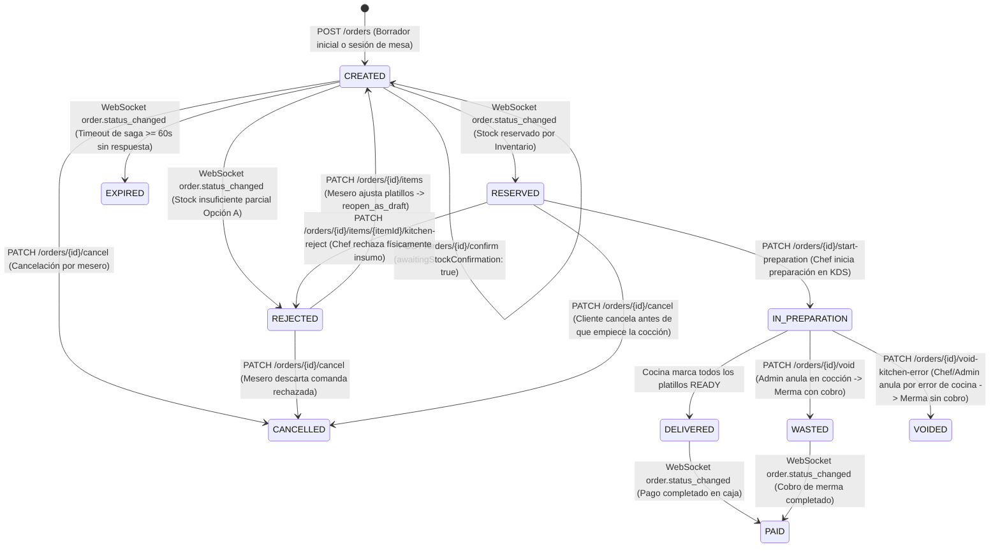

# Arquitectura de Comunicación e Integración de Clientes — Frontend de Órdenes y Cocina (orders-frontend)

> Este documento define la arquitectura y los contratos de comunicación desde la perspectiva del **cliente frontend (`orders-frontend`)**, que agrupa las aplicaciones cliente del restaurante: la **App móvil/tablet del mesero** (incluyendo el widget federado `OrderTicketWidget`), el **Monitor de Mesas / Mapa de Sala** y la **Pantalla KDS de Cocina** (`KdsBoard`).  
> Especifica cómo interactúan estos componentes con la API REST y los canales en tiempo real WebSocket expuestos por `orders-backend`, los esquemas Zod de validación en la frontera del cliente, el ciclo de vida de los 10 estados de comanda (`OrderStatus`) y el impacto en la interfaz de usuario de las decisiones del Sprint 4 (ADR-0012 a ADR-0018).

---

## 0. Aclaración previa: comunicación del frontend y frontera del sistema

1. **El frontend interactúa exclusivamente con la API de Órdenes y Cocina:** Los clientes web y módulos federados no se conectan directamente a la base de datos PostgreSQL, a Redis ni al broker RabbitMQ. Todas las operaciones de usuario se realizan mediante:
   - **Peticiones HTTP/REST síncronas:** Para emitir comandos de usuario (crear comanda, agregar/quitar ítems, confirmar, iniciar preparación física en cocina, rechazar insumos en cocina, marcar platillos listos o cancelar).
   - **Canales bidireccionales WebSocket:** Para recibir en tiempo real las actualizaciones de estado de órdenes y platillos empujadas por el backend tras consolidar transacciones o consumir eventos asíncronos de otros microservicios (Inventario, Pagos, Sala, Menú).
2. **Desacoplamiento asíncrono y reactividad de UI:**
   - Cuando el mesero pulsa "Confirmar" en la app/widget, la respuesta HTTP `200 OK` indica únicamente que la comanda fue recibida y está en espera de validación de existencias (`awaitingStockConfirmation: true` en estado `CREATED`).
   - El paso a la cola de cocina **no es inmediato ni síncrono**: ocurre cuando Inventario valida y reserva stock emitiendo `inventario.stock.reservado`. En ese instante, el backend transiciona la orden a `RESERVED` (`stock_reserved_at`) y empuja la actualización por WebSocket a la pantalla KDS y a la tablet del mesero.
   - El descuento definitivo de inventario se ejecuta cuando el Chef inicia la preparación física en la pantalla KDS (`PATCH /orders/{orderId}/start-preparation`), lo cual emite `ordenes.orden.en_preparacion`.
3. **Manejo de identidad y seguridad:** El frontend adjunta el token JWT obtenido del proveedor de autenticación (`tokenProvider`) en el encabezado `Authorization: Bearer <token>` de cada petición REST y en el handshake de WebSocket. La validación criptográfica de firma es responsabilidad del API Gateway (ADR-0011); el frontend nunca envía `userId`, `role` ni marcas de tiempo en el cuerpo de peticiones de mutación.

| Canal en el Frontend | Protocolo | Endpoint / Destino | Propósito en la UI |
|---|---|---|---|
| **API REST (FastAPI)** | HTTP/JSON | `https://<api-host>/api/v1/...` | Comandos de usuario, consultas de catálogo/cola y cambios de estado |
| **Stream en Tiempo Real** | WebSocket | `wss://<api-host>/ws/waiter` | Notificaciones en piso/sala para meseros (`floor`, `user:{userId}`) |
| **Stream en Tiempo Real** | WebSocket | `wss://<api-host>/ws/kds` | Notificaciones de cocina por estación (`kds:station:{station}`, `kds:all`) |

---

## 1. Capa síncrona: API REST y Contratos de Cliente

Esta capa atiende a los dispositivos físicos del restaurante: handhelds/tablets Android de meseros y monitores táctiles landscape 1920×1080 (con soporte secundario de teclado/Bump Bar) en cocina.

### 1.1 Principios de diseño para el frontend

- **Validación estricta con esquemas Zod en la frontera del cliente (`src/shared/api/schemas.ts`):** Todas las respuestas del backend son parseadas y validadas con Zod antes de alimentar el estado de React. Respuestas que violen el contrato generan fallos explícitos en tiempo de desarrollo/pruebas y evitan estados inconsistentes en la UI.
- **Ciclo de vida formal de 10 estados de comanda (`OrderStatus`) y 4 estados de ítem (`ItemStatus`):**
  - `OrderStatus`: `CREATED`, `RESERVED`, `IN_PREPARATION`, `DELIVERED`, `PAID`, `CANCELLED`, `REJECTED`, `WASTED`, `VOIDED`, `EXPIRED`.
  - `ItemStatus`: `PENDING`, `READY`, `DELIVERED`, `CANCELLED`.
- **Precios congelados y validación previa de disponibilidad (`< 1 ms`):** El backend valida la disponibilidad del platillo contra su caché en Redis antes de agregarlo al borrador. Si un platillo fue agotado o rechazado físicamente en cocina, el backend responde `422 Unprocessable Entity` con código `DISH_UNAVAILABLE`, impidiendo que el mesero agregue productos sin existencia física.
- **Transiciones optimistas vs confirmadas:** Las acciones de la interfaz actualizan el estado visual tras recibir el `200 OK` del endpoint REST y sincronizan cualquier cambio concurrente a través del stream WebSocket utilizando el campo `version` monótono para evitar condiciones de carrera.



---

### 1.2 Catálogo de Endpoints por Vista y Componente

#### Vista 1 — Monitor de Mesas y Listado de Comandas (Sala / Mesero)

| Método | Ruta | Roles | Esquema Zod / DTO | Comportamiento y Uso en el Frontend |
|---|---|---|---|---|
| `GET` | `/orders?status=&diningSessionId=` | `waiter`, `admin` | `z.array(OrderSchema)` | Lista comandas activas. Permite filtrar por estado (`status`) y/o por sesión de mesa (`diningSessionId`). Soporta la relación **`1:N` entre sesión de mesa y órdenes** para renderizar todas las rondas de pedido de los comensales. |
| `GET` | `/orders/{orderId}` | `waiter`, `admin` | `OrderSchema` | Obtiene el detalle completo de la orden para inicializar o refrescar `OrderTicketWidget`. Incluye `stockReservedAt`, `inPreparationAt`, `rejectionDetails` y el desglose de ítems con sus modificadores y notas. |
| `POST` | `/orders` | `waiter`, `admin` | `CreateOrderInputSchema` → `OrderSchema` | Crea una comanda en borrador (`CREATED`). Acepta `tableId` (mesa física), `orderType: "dine_in" \| "takeaway"` y el identificador opcional `diningSessionId`. |

---

#### Vista 2 — Gestor de Comanda (`OrderTicketWidget` — Mesero)

`OrderTicketWidget` es un componente React exportado como Microfrontend (Module Federation) e integrable en la app host del menú o tablet del mesero.

```typescript
export interface OrderTicketWidgetProps {
  readonly orderId: string;
  readonly userId?: string;
  readonly tokenProvider?: () => Promise<string> | string;
  readonly apiBaseUrl?: string;
  readonly wsBaseUrl?: string;
  readonly diningSessionId?: string;
  readonly onCreateNewOrder?: () => void;
}
```

##### Operaciones REST del Widget:

1. **Actualización de Ítems y Reapertura de Borrador (`PATCH /orders/{orderId}/items`):**
   - **En `CREATED` sin `confirmedAt`:** Actualiza la lista de platillos, cantidades, notas y modificadores en el borrador.
   - **En `CREATED` con `confirmedAt`:** El backend rechaza con `409 Conflict` (`INVALID_STATE_TRANSITION`) ya que la orden está bloqueada esperando respuesta de Inventario.
   - **En `REJECTED` (Reapertura Editable Opción A · ADR-0016):** Al enviar la modificación de ítems, el backend ejecuta automáticamente `order.reopen_as_draft()`, regresando la orden a `CREATED` y limpiando `confirmedAt` y `rejectionDetails` sobre el **mismo `orderId`**. Esto permite al mesero ajustar la cantidad o sustituir el platillo agotado sin perder el identificador de orden ni crear una comanda desde cero.
2. **Confirmación de Comanda (`POST /orders/{orderId}/confirm`):**
   - **Idempotente.** Fija `confirmedAt` y `confirmedBy`. Si la orden ya estaba confirmada o en preparación, responde `200 OK` sin duplicar eventos.
   - Si la comanda estaba en `REJECTED`, el botón de confirmar permanece inactivo hasta que se ejecute la modificación de ítems (reapertura a `CREATED`).
3. **Cancelación de Comanda (`PATCH /orders/{orderId}/cancel` o `POST`):**
   - **Permitido en:** `CREATED`, `RESERVED` y `REJECTED`.
   - Si la orden tenía reservas en Inventario (`RESERVED` o pre-reserva parcial en `REJECTED`), el backend emite `ordenes.orden.cancelada` para liberarlas.
   - **Bloqueado en `IN_PREPARATION`:** Si la cocción ya inició, el backend responde `409 Conflict`. La orden solo podrá cancelarse administrativamente con merma (`WASTED`) o por error de cocina (`VOIDED`).
4. **Transferencia de Mesa (`PATCH /orders/{orderId}/transfer`):**
   - Cambia el `tableId` enviando `{ "newTableId": string, "version": number }`. Controla concurrencia mediante `version`.
5. **Rehechura de Ítem Entregado (`PATCH /orders/{orderId}/items/{itemId}/redo` · OP-12):**
   - Disponible sobre órdenes en `DELIVERED` cuando un comensal devuelve un platillo por insatisfacción. Exige cuerpo `{ "note": string }`. La orden matriz conserva el estado `DELIVERED` y el ítem transiciona a `PENDING`.

##### Comportamiento Visual y Accesibilidad del Widget:

- **Estado `RESERVED`:** Muestra la insignia visual con estilo advertencia/reserva "Reservado en cocina" (`[data-status="RESERVED"]`). El botón "Cancelar comanda" se mantiene activo porque aún no entra a cocción física.
- **Estado `REJECTED` con Pre-Reserva Parcial:**
  - Renderiza una sección destacada con `role="alert"` y `aria-live="assertive"` conteniendo el desglose de `rejectionDetails`:
    - **Platillos rechazados (`rejectedItems`):** Nombre/oferta, cantidad solicitada y cantidad disponible (ej. *"Solicitados: 3, Disponibles: 1"*).
    - **Platillos pre-reservados (`reservedItems`):** Platillos que sí alcanzaron y se mantienen apartados temporalmente en cocina.
    - **Ingredientes faltantes (`missingIngredients`):** Lista de insumos agotados reportados por Inventario o por el Chef.
  - Habilita el botón **"Modificar comanda"**, permitiendo ajustar cantidades en línea o quitar ítems para reabrir automáticamente la comanda a `CREATED`.
- **Estado `EXPIRED`:** Muestra alerta de tiempo de espera agotado (timeout de saga 60 s) e invoca `onCreateNewOrder` si el usuario decide iniciar una nueva comanda.
- **Estado `DELIVERED`:** Muestra el banner informativo *"Entregada por cocina — lista para recoger"* alertando al mesero para llevar la charola a la mesa.

---

#### Vista 3 — Pantalla KDS (Cocina: Monitor Táctil Landscape 1920×1080 y Bump Bar)

| Método | Ruta | Roles | Comportamiento y Uso en Cocina |
|---|---|---|---|
| `GET` | `/kds/queue?station=&view=` | `kitchen`, `chef`, `admin` | Devuelve la cola de comandas de cocina.<br>• `view=active` (por defecto): Incluye órdenes en **`RESERVED`**, **`IN_PREPARATION`** y aquellas **`DELIVERED` con al menos un ítem `PENDING`** (rehechuras OP-12).<br>• **Ordenamiento FIFO por antigüedad en cocina (OP-11 cerrado):** `COALESCE(in_preparation_at, stock_reserved_at, created_at) ASC`, desempatando por `created_at ASC` y `public_id ASC`.<br>• Permite filtrar por estación (`station`: parrilla, barra, fría). |
| `PATCH` | `/orders/{orderId}/start-preparation` | `kitchen`, `chef`, `admin` | **Inicio manual de cocción (ADR-0014):** El Chef pulsa "Iniciar preparación" sobre una tarjeta en `RESERVED`. La orden pasa a `IN_PREPARATION`, estampa `inPreparationAt` y emite `ordenes.orden.en_preparacion` hacia Inventario para el descuento definitivo de insumos. |
| `PATCH` | `/orders/{orderId}/items/{itemId}/kitchen-reject` | `kitchen`, `chef`, `admin` | **Rechazo físico de insumo en cocina (ADR-0015):** Si el Chef detecta en `RESERVED` que no hay insumo físico, abre el diálogo de rechazo enviando `{ "reason": string }`. La orden regresa a `REJECTED`, el platillo queda bloqueado en Redis local (`422 DISH_UNAVAILABLE`) y el mesero recibe la alerta en tiempo real en su tablet. |
| `PATCH` | `/orders/{orderId}/items/{itemId}/cancel` | `kitchen`, `chef`, `admin` | Cancela un renglón individual (`PENDING -> CANCELLED`) recalculando el total de la orden. |
| `PATCH` | `/orders/{orderId}/items/{itemId}/ready` | `kitchen`, `chef`, `admin` | Marca un platillo como `READY`. Si todos los ítems activos de la orden quedan listos, la orden transiciona automáticamente a `DELIVERED`. |
| `PATCH` | `/orders/{orderId}/ready` | `kitchen`, `chef`, `admin` | Marca la comanda completa como `READY` pasando la orden a `DELIVERED`. |

---

#### Acciones Administrativas y de Merma (Solo sobre órdenes en preparación)

| Método | Ruta | Roles | Comportamiento y Uso |
|---|---|---|---|
| `PATCH` | `/orders/{orderId}/void` | `admin` | Anulación administrativa con cobro (`IN_PREPARATION -> WASTED`). Requiere rol `admin`. Si la comanda aún estaba en `RESERVED`, no genera merma sino cancelación limpia (`/cancel`). |
| `PATCH` | `/orders/{orderId}/void-kitchen-error` | `admin`, `chef` | Anulación por error o accidente de cocina sin cobro al cliente (`IN_PREPARATION -> VOIDED`). Requiere cuerpo `{ "note": string }`. |

---

### 1.3 Notificación en Tiempo Real: Canales WebSocket y Flujo de Cliente

El frontend establece conexión WebSocket persistente para evitar polling repetitivo. Todas las mutaciones relevantes de base de datos disparan notificaciones push inmediatamente después de confirmarse en PostgreSQL.

#### Topología de Canales WebSocket

| Canal | Endpoint | Roles | Modo de suscripción | Uso en el Frontend |
|---|---|---|---|---|
| `floor` | `/ws/waiter` | `waiter`, `admin` | Automático al conectar | Monitor de mesas y vistas de sala. Notifica cambios de todas las órdenes activas. |
| `user:{userId}` | `/ws/waiter` | `waiter`, `admin` | Automático desde claim JWT | `OrderTicketWidget` y alertas personales del mesero (`RESERVED`, `REJECTED`, `EXPIRED`, `DELIVERED`). |
| `kds:station:{station}` | `/ws/kds` | `kitchen`, `chef`, `admin` | Solicitado por el cliente con `{ "type": "subscribe", "channels": [...] }` | Tarjetas KDS asignadas a una estación específica (parrilla, barra, etc.). |
| `kds:all` | `/ws/kds` | `kitchen`, `chef`, `admin` | Solicitado por el cliente | Vista global del jefe de cocina/admin con todas las órdenes activas. |

#### Esquemas de Mensajes WebSocket (`src/shared/realtime/schemas.ts`)

##### 1. Cambio de Estado de Orden (`order.status_changed`) — Caso Estándar:
```json
{
  "type": "order.status_changed",
  "eventId": "7c9e6679-7425-40de-944b-e07fc1f90ae7",
  "occurredAt": "2026-10-31T14:22:10Z",
  "orderId": "9c25e121-8623-4084-9c25-52d1906d4dfb",
  "tableId": "MESA-04",
  "status": "RESERVED",
  "version": 3,
  "rejectionDetails": null
}
```

Para una transición a `DELIVERED` entregada también al canal compartido `floor`, el evento incluye `responsibleWaiterId` con el identificador del mesero asignado. Los consumidores filtran con ese campo para no alertar a otros meseros.

##### 2. Cambio de Estado de Orden (`order.status_changed`) — Rechazo con Pre-Reserva Parcial (Opción A):
```json
{
  "type": "order.status_changed",
  "eventId": "3f8b12a0-55c1-4890-b123-9876543210fe",
  "occurredAt": "2026-10-31T14:20:05Z",
  "orderId": "9c25e121-8623-4084-9c25-52d1906d4dfb",
  "tableId": "MESA-04",
  "status": "REJECTED",
  "version": 2,
  "rejectionDetails": {
    "missingIngredients": ["carne-res"],
    "rejectedItems": [
      {
        "offerId": "b57f7e2a-02a4-4fb7-bb41-55f2d974b101",
        "requestedQuantity": 3,
        "availableQuantity": 1
      }
    ],
    "reservedItems": [
      {
        "offerId": "b57f7e2a-02a4-4fb7-bb41-55f2d974b101",
        "quantity": 1
      },
      {
        "offerId": "a12b34c5-67d8-49e0-f123-456789abcdef",
        "quantity": 2
      }
    ]
  }
}
```

##### 3. Cambio de Estado de Ítem (`item.status_changed`):
```json
{
  "type": "item.status_changed",
  "eventId": "f1d2c3b4-a596-4877-8123-456789abcdef",
  "occurredAt": "2026-10-31T14:25:30Z",
  "orderId": "9c25e121-8623-4084-9c25-52d1906d4dfb",
  "tableId": "MESA-04",
  "itemId": "11223344-5566-7788-99aa-bbccddeeff00",
  "status": "READY",
  "version": 5
}
```

#### Reglas de Cliente WebSocket en React

1. **Autenticación en el Handshake:** El token se envía mediante el protocolo acordado con el Gateway (subprotocolo o cabecera). Si el token no es válido o expira, el socket se cierra con código `4401`. Si el rol del usuario no tiene acceso al endpoint, se cierra con `4403`.
2. **Reconexión con Backoff Exponencial:** Si la conexión se pierde, el cliente intenta reconectar a intervalos incrementales (1s, 2s, 4s, 8s, hasta un máximo de 30s) y realiza un `GET /orders/{orderId}` de reconciliación al recuperar la sesión.
3. **Ordenamiento por Versión Monótona:** Si llega un mensaje con `version <= currentOrder.version`, el frontend lo descarta silenciosamente para prevenir sobrescrituras por mensajes fuera de orden.

---

## 2. Visibilidad del Ciclo Asíncrono de Mensajería (RabbitMQ)

Aunque el frontend no se conecta a RabbitMQ, los desarrolladores de interfaz deben comprender los eventos que intercambia el backend con otros microservicios, ya que **cada uno de ellos determina las transiciones visibles en la UI**.

### 2.1 Matriz de Eventos de Dominio y su Efecto en la Interfaz

| Evento en RabbitMQ | Origen / Destino | Causa en Backend | Efecto Resultante en la Interfaz de Usuario |
|---|---|---|---|
| `ordenes.orden.creada` | Publica a Inventario | Mesero pulsa "Confirmar" (`POST /confirm`) | La orden muestra el banner *"Pendiente de confirmación de stock"* en estado `CREATED`. Edición bloqueada. |
| `inventario.stock.reservado` | Consume de Inventario | Inventario aparta insumos con TTL | Orden pasa a `RESERVED`. La tarjeta aparece en la cola activa del KDS. En la tablet del mesero se muestra la insignia "Reservado en cocina". |
| `inventario.stock.insuficiente` | Consume de Inventario | Insumos insuficientes (Opción A) | Orden pasa a `REJECTED`. El mesero recibe alerta instantánea (`< 500 ms`) con el desglose de faltantes y el botón para modificar cantidades sin reiniciar la orden. |
| `ordenes.orden.en_preparacion` | Publica a Inventario | Chef pulsa "Iniciar preparación" en KDS | Orden pasa a `IN_PREPARATION`. Se apaga la posibilidad de cancelar sin merma en la tablet del mesero. El cronómetro de cocción comienza a correr. |
| `ordenes.platillo.rechazado_cocina` | Publica a Inventario y Menú | Chef detecta falta física de insumo en KDS | Orden regresa de `RESERVED` a `REJECTED`. El platillo se bloquea en la app del mesero (`422 DISH_UNAVAILABLE`). Se alerta al mesero para sustituir el platillo. |
| `ordenes.platillo.preparado` | Publica a Inventario | Cocinero marca ítem listo en KDS | El renglón cambia a estado `READY` en la pantalla KDS. Si todos los ítems concluyen, la orden pasa a `DELIVERED`. |
| `ordenes.orden.cancelada` | Publica a Inventario | Mesero cancela en `CREATED`, `RESERVED` o `REJECTED` | La comanda se archiva como `CANCELLED`. Se libera cualquier reserva en Inventario. |
| `ordenes.orden.expirada` | Publica a Inventario | Watcher supera 60s sin respuesta | La orden pasa a `EXPIRED`. El widget del mesero muestra alerta de tiempo agotado y habilita crear una nueva orden. |
| `pagos.pago.completado` | Consume de Pagos | Comensal paga su cuenta en caja | La orden pasa a `PAID` (estado terminal) y desaparece definitivamente del monitor de mesas activas y KDS. |

---

## 3. Estado de Puntos Abiertos y Acuerdos de Arquitectura

1. **OP-01: `SAGA_TIMEOUT_SECONDS` (ADR-0001)** — **[Cerrado]** Límite estricto de 60 segundos tras pulsar "Confirmar". Si expira, la interfaz refleja el estado terminal `EXPIRED`.
2. **OP-02: Canales WebSocket y Roles (ADR-0002)** — **[Cerrado]** Endpoints `/ws/kds` y `/ws/waiter` estructurados por canal (`kds:station:{station}`, `kds:all`, `floor`, `user:{userId}`).
3. **OP-03: Colores Semánticos y Tokens de UI (ADR-0003)** — **[Cerrado]** Tokens de paleta bajo el selector `.orders-kds-root` (`--color-success`, `--color-warning`, `--color-error`, `--color-info`).
4. **OP-05: Idempotencia de Confirmación y Reapertura (ADR-0004 / ADR-0016)** — **[Cerrado]** `POST /confirm` es idempotente. Si la orden fue rechazada (`REJECTED`), editar ítems mediante `PATCH /items` reabre a borrador `CREATED` sobre el mismo `orderId`.
5. **OP-06: Interacción Táctil y Bump Bar en KDS (ADR-0005)** — **[Cerrado]** Monitor táctil como interfaz primaria (objetivos de 64 px), teclado/Bump Bar secundario con paridad total.
6. **OP-07: Rutas y Esquemas REST en Inglés (ADR-0006)** — **[Cerrado]** Endpoints, parámetros y contratos en inglés (`/orders`, `/kds/queue`, `note`, `reason`).
7. **OP-08: Quién Marca "Entregado" (ADR-0007)** — **[Cerrado]** Cocina marca el último platillo `READY` y la orden pasa automáticamente a `DELIVERED`. No existe endpoint `deliver` para el mesero.
8. **OP-09: Metadatos de Menú como Texto de Referencia (ADR-0008)** — **[Cerrado]** `station` y `preparationTime` son strings informativos sanitizados contra inyecciones XSS.
9. **OP-11: Prioridad de Cola KDS y Estado `RESERVED` (ADR-0009 / ADR-0013)** — **[Cerrado]** Cola activa incluye órdenes en `RESERVED` e `IN_PREPARATION`, ordenadas por `COALESCE(in_preparation_at, stock_reserved_at, created_at) ASC`.
10. **OP-12: Rehechura de Platillo en Orden `DELIVERED` (Sprint 5 · TASK-32 / TASK-23)** — **[Pendiente de evento final con Inventario]** La orden matriz se mantiene en `DELIVERED` y el ítem regresa a `PENDING` solicitando nota obligatoria en la UI del mesero.
11. **OP-13: Recepción de Aviso `DELIVERED` para Meseros (Sprint 6 · INT-03)** — **[Opción B seleccionada; integración por acordar con Sala]** Órdenes expone el componente federado `ReadyOrdersAlert`, que consume `/ws/waiter` y filtra `DELIVERED` por `responsibleWaiterId`.
