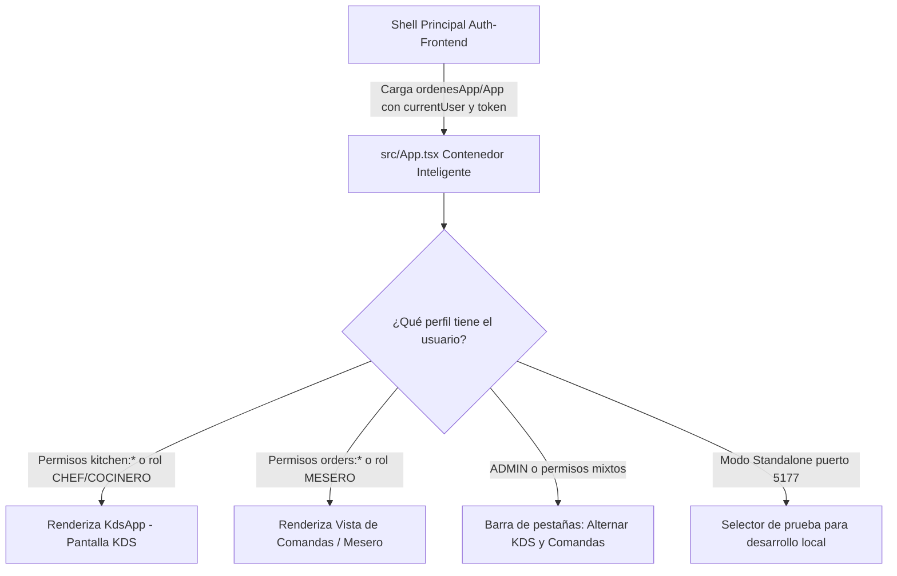

# Análisis y Guía de Integración con el Shell Microfrontend (Frontend)

> **Módulo:** Órdenes y Cocina (KDS) — `orders-frontend`  
> **Destinatario:** Desarrolladores de Frontend de Orders-KDS y Equipo de Integración  
> **Fecha:** 11 de Noviembre de 2026  
> **Estado:** Documentación Técnica de Arquitectura y Plan de Cambios  

---

## 1. Resumen Ejecutivo y Diagnóstico del Entorno

El Shell principal del restaurante (`Auth-Frontend`) está construido en **React 18**, **Vite** y `@originjs/vite-plugin-federation`. Actúa como el host contenedor que autentica a los usuarios, administra los roles y permisos PBAC, y monta dinámicamente cada microfrontend según el módulo seleccionado en su barra lateral.

### Contrato Oficial del Shell para este Módulo:
* **Identificador en Federation:** `ordenes_app` (el Shell lo importa como `ordenesApp`)
* **Endpoint de entrada remota:** `http://localhost:5177/assets/remoteEntry.js`
* **Componente raíz importado por el Shell:** `ordenesApp/App` (`./src/App.tsx`)
* **Puerto fijo local:** `5177`
* **Ruta en API Gateway (Kong):** `http://localhost:8000/api/v1/orders`
* **Prefijos de permisos autorizados:** `orders:` y `kitchen:`

> [!WARNING]
> **Atención al trabajo en paralelo:** Actualmente se están realizando ajustes visuales y de diseño en tiempo real en los componentes del tablero KDS (`OrderCard.tsx`, `OrderCardStub.tsx`, `StationSelector.tsx`, etc.). Los cambios descritos en este documento deben implementarse de forma coordinada, respetando los archivos de estilos que están siendo intervenidos.

---

## 2. Inyección de las Dos Interfaces del Microservicio en el Shell

El microservicio de Órdenes y Cocina cuenta con **dos interfaces de usuario principales**:
1. **Pantalla KDS de Cocina (`KdsApp.tsx`):** Diseñada para la línea caliente, planchas y freidoras. Orientada a pantallas táctiles y teclado industrial (Bump Bar).
2. **Gestión de Comandas / Toma de Pedidos (`OrderTicketWidget.tsx` / Vista de Pedidos):** Diseñada para meseros y sala, permitiendo capturar comandas, editar platillos, confirmar pedidos a cocina y solicitar la cuenta.

### El Reto de Arquitectura
El Shell solo monta un único componente raíz por microservicio:
```tsx
const RemoteOrdenesApp = React.lazy(() => import('ordenesApp/App'));
```
No tiene rutas separadas en el menú principal para "KDS" y "Comandas", sino un único módulo: **"Órdenes y Cocina"** (`id: 'ordenes'`).

### La Solución: Componente Contenedor Orquestador (`src/App.tsx`)
`src/App.tsx` debe actuar como un orquestador inteligente que recibe las propiedades federadas del Shell (`FederatedModuleProps`):



#### Propuesta de Implementación para `src/App.tsx`:
```tsx
import React, { useState, useEffect } from 'react';
import KdsApp from './KdsApp';
import OrderTicketWidget from './OrderTicketWidget';
import type { FederatedModuleProps, ShellUser } from './types/federation';

export default function App({ token, currentUser, theme }: Readonly<FederatedModuleProps>) {
  // 1. Obtener sesión efectiva (props del Shell o localStorage)
  const [activeUser, setActiveUser] = useState<ShellUser | null>(currentUser ?? null);
  const [activeView, setActiveView] = useState<'kds' | 'orders'>('kds');

  useEffect(() => {
    if (!currentUser) {
      try {
        const raw = localStorage.getItem('fmat_restaurant_auth_session');
        if (raw) {
          const parsed = JSON.parse(raw);
          setActiveUser(parsed.user);
        }
      } catch (err) {
        console.error('Error leyendo sesión del shell:', err);
      }
    } else {
      setActiveUser(currentUser);
    }
  }, [currentUser]);

  // 2. Determinar vistas disponibles según PBAC
  const hasKitchen = activeUser?.userType === 'ADMIN' || 
    activeUser?.permissions.some(p => p.startsWith('kitchen:') || p === '*');
  const hasOrders = activeUser?.userType === 'ADMIN' || 
    activeUser?.permissions.some(p => p.startsWith('orders:') || p === '*');
  const isAdmin = activeUser?.userType === 'ADMIN' || activeUser?.permissions.includes('*');

  // Ajustar vista inicial por rol predominante
  useEffect(() => {
    if (hasKitchen && !hasOrders) setActiveView('kds');
    else if (!hasKitchen && hasOrders) setActiveView('orders');
  }, [hasKitchen, hasOrders]);

  return (
    <div className="w-full h-full flex flex-col">
      {/* Barra de alternancia visible solo para Admin o usuarios con doble rol */}
      {(isAdmin || (hasKitchen && hasOrders)) && (
        <header className="flex items-center justify-between px-6 py-2 bg-surface border-b border-border text-sm">
          <span className="font-semibold text-ink">Módulo Órdenes & Cocina</span>
          <div className="flex gap-2 bg-canvas p-1 rounded-lg border border-border">
            <button
              type="button"
              onClick={() => setActiveView('kds')}
              className={`px-3 py-1 rounded font-medium transition-colors ${
                activeView === 'kds' ? 'bg-fmat-primary text-white shadow-sm' : 'text-muted hover:text-ink'
              }`}
            >
              Pantalla Cocina (KDS)
            </button>
            <button
              type="button"
              onClick={() => setActiveView('orders')}
              className={`px-3 py-1 rounded font-medium transition-colors ${
                activeView === 'orders' ? 'bg-fmat-primary text-white shadow-sm' : 'text-muted hover:text-ink'
              }`}
            >
              Gestión de Comandas
            </button>
          </div>
        </header>
      )}

      {/* Renderizado de la vista seleccionada */}
      <main className="flex-1 w-full overflow-hidden">
        {activeView === 'kds' ? (
          <KdsApp />
        ) : (
          <div className="p-6 max-w-4xl mx-auto">
            {/* Widget de comanda activa o selector de órdenes para mesero */}
            <OrderTicketWidget orderId="ord-101" />
          </div>
        )}
      </main>
    </div>
  );
}
```

---

## 3. Cambios Técnicos Necesarios en el Repositorio Frontend

### 3.1. Alinear versión de React con el Shell (Requisito Crítico de Module Federation)
* **Situación actual:** `orders-frontend/package.json` tiene React 19 (`"react": "^19.0.0"`, `"react-dom": "^19.0.0"`).
* **Requisito del Shell:** `Auth-Frontend` corre en React 18 (`^18.3.1`).
* **Riesgo técnico:** Como Module Federation comparte la instancia de React en tiempo de ejecución (`shared: ['react', 'react-dom']`), cuando el Shell (React 18) intente renderizar un componente compilado contra el runtime de React 19, fallará con:
  > `Error: Objects are not valid as a React child (found: object with keys {$$typeof, type, key, ref, props, _owner})`
* **Acción requerida (cuando se apruebe la fase de dependencias):**
  ```bash
  pnpm add react@^18.3.1 react-dom@^18.3.1
  pnpm add -D @types/react@^18.3.18 @types/react-dom@^18.3.5
  ```

---

### 3.2. Configuración de Module Federation en `vite.config.ts`
Debemos ajustar la configuración de federación para alinearse estrictamente al contrato de `Auth-Frontend`:

```diff
- name: 'ordersKds',
+ name: 'ordenes_app',
  filename: 'remoteEntry.js',
  exposes: {
+   './App': './src/App.tsx',
    './KdsApp': './src/KdsApp.tsx',
    './IntermediateDishesApp': './src/IntermediateDishesApp.tsx',
    './OrderTicketWidget': './src/OrderTicketWidget.tsx',
    './ReadyOrdersAlert': './src/ReadyOrdersAlert.tsx',
  },
  shared: ['react', 'react-dom'],
```

Y fijar el puerto en `5177` con CORS habilitado:
```ts
server: {
  port: 5177,
  strictPort: true,
  cors: true,
  host: true,
},
preview: {
  port: 5177,
  strictPort: true,
  cors: true,
  host: true,
},
```

---

### 3.3. Configuración de Comunicación con el API Gateway (Kong)
En lugar de apuntar al backend directo, todas las peticiones HTTP del frontend deben fluir a través de la ruta del API Gateway:
* **Ruta Gateway:** `http://localhost:8000/api/v1/orders` (Kong tiene `strip_path: false` configurado para `~/api/v1/orders(/|$)`).
* **Configuración en `.env`:**
  ```env
  VITE_API_URL=http://localhost:8000/api/v1/orders
  VITE_WS_URL=ws://localhost:8000/api/v1/orders/ws
  ```
* **Consideración de CORS en el Gateway:**
  - Cuando el microfrontend corre embebido dentro del Shell (`http://localhost:3000`), el origen es `http://localhost:3000`, el cual ya está autorizado por defecto en `CORS_ORIGINS` de `API-Gateway/.env`.
  - Si se prueba en modo **standalone** (`http://localhost:5177`) contra el Gateway, se debe asegurar que `http://localhost:5177` esté listado en la variable `CORS_ORIGINS` del `API-Gateway/.env`.
* **Inyección de Token Bearer:**
  En `src/shared/api/client.ts`, el interceptor de peticiones debe resolver el token con esta prioridad:
  1. Token recibido en props del Shell (`token`).
  2. Token almacenado en `localStorage.getItem('fmat_restaurant_auth_session')` (`accessToken`).
  3. Token de desarrollo mock (solo en modo `standalone`).

---

### 3.4. Respeto al Tema del Shell (`data-theme="dark"`)
El Shell aplica el tema en la raíz del documento:
`<html data-theme="dark">` o `<html data-theme="light">`.

El trabajo de estilos que se está realizando actualmente en el equipo (reemplazando colores quemados `bg-gray-800` por variables semánticas `bg-surface`, `border-border`, `text-body`, `text-ink`) es **completamente compatible y necesario**. Se debe asegurar que `src/index.css` incluya la paleta oficial del restaurante para que al alternar el modo oscuro en el Shell, los componentes de ÓrdenesKDS respondan instantáneamente.

---

### 3.5. Scripts en `package.json`
Agregar el script de previsualización federada:
```json
"scripts": {
  "dev:federation": "vite build && vite preview --port 5177"
}
```

---

## 4. Hoja de Ruta Precavida para la Implementación

Para no interferir con las modificaciones de estilos que se están ejecutando en tiempo real:

1. **Fase 1 (Inmediata - Sin riesgo):**
   - El equipo termina de pulir y commitear los estilos visuales de `OrderCard.tsx`, `KdsBoard.tsx`, etc.
   - Se valida que `test:coverage` continúe al 100%.
2. **Fase 2 (Federación y Contenedor):**
   - Implementar el contenedor `src/App.tsx` con soporte para `FederatedModuleProps` y alternancia de vistas KDS / Comandas.
   - Ajustar `vite.config.ts` para fijar el puerto `5177` y exportar `'./App': './src/App.tsx'`.
3. **Fase 3 (Alineación de React 18):**
   - En una rama dedicada o tras asentar los estilos, instalar `react@^18.3.1` y validar que el build federado sea consumido limpiamente por `Auth-Frontend` corriendo en el puerto `3000`.
